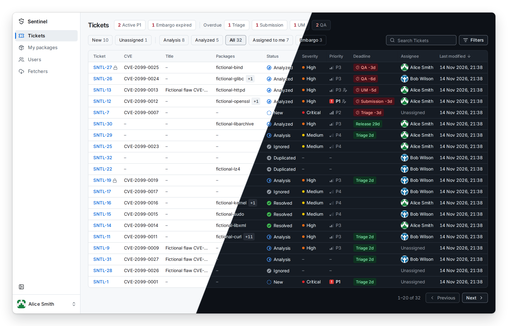
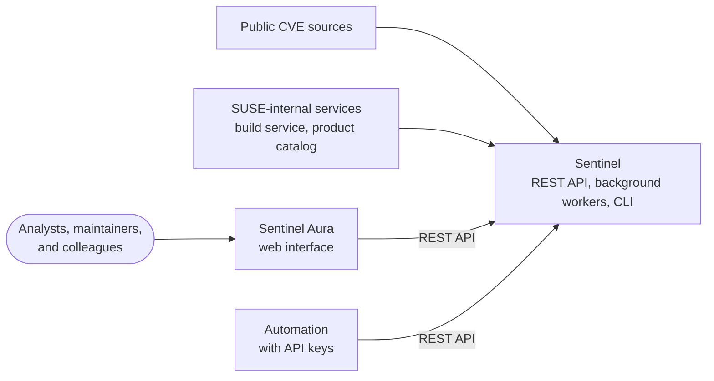

<picture>
<source media="(prefers-color-scheme: dark)" srcset="assets/banner-dark.svg">

</picture>

Sentinel is the security update management platform for SUSE and
openSUSE-based Linux distributions, developed by the SUSE Security Team. It
tracks CVEs from public sources, analyzes their impact on packages,
codestreams, and products, and follows each update through the SUSE
maintenance workflow until its fix is released.

> [!NOTE]
> **Internal, non-commercial projects.** Sentinel and Sentinel Aura are
> internal tools of the SUSE Security Team, published as open source. They
> are not commercial products: SUSE does not sell, market, or offer them as
> products or services. They are not related to, affiliated with, or endorsed
> by any other product or company that uses the name Sentinel. All trademarks
> belong to their respective owners.

## Projects

| Project | What it is | Release |
|---|---|---|
| [**Sentinel**](https://github.com/vulnwatch/sentinel) | The platform: CVE ingestion, security Tickets, impact analysis, and the REST API, with a CLI for administration |  |
| [**Sentinel Aura**](https://github.com/vulnwatch/sentinel-aura) | The web interface, for the analysts who triage and follow their queues, the package maintainers who deliver the fixes, and every colleague who needs SUSE's status for a CVE |  |

 
Sentinel Aura in the light and the dark theme, with fictional data from Sentinel's example dataset.

<a href="https://vulnwatch.github.io/aura-tutorials/"><strong>New to Sentinel Aura? Watch its tutorials, chosen by role.</strong></a>

## How It Fits Together

## Principles

- **API-first.** The REST API is Sentinel's primary interface: every operation
  that the web interface, the CLI, or an automation needs is available through
  it.
- **A specified contract.** Sentinel specifies every feature before it
  implements it, and publishes the OpenAPI document of each release; Sentinel
  Aura is built and tested against one exact version of that contract.
- **Verifiable releases.** Every release publishes its OCI image with a
  CycloneDX SBOM and signed build provenance, bound to the image's digest.
- **Accessible.** Sentinel Aura is designed to meet WCAG 2.2 at levels A and
  AA, in its light and its dark theme.

## Links

- **Tutorials:** narrated videos that show each role what it can do in
  Sentinel Aura, at [vulnwatch.github.io/aura-tutorials](https://vulnwatch.github.io/aura-tutorials/).
- **API documentation:** the interactive documentation of the latest Sentinel
  release, at [vulnwatch.github.io/sentinel](https://vulnwatch.github.io/sentinel/).
- **Security:** report vulnerabilities to the SUSE Security Team as the
  [security policy](https://github.com/vulnwatch/sentinel/security/policy)
  describes, never in a public issue.
- **Issues:** the backend and its API in
  [Sentinel](https://github.com/vulnwatch/sentinel/issues), the web interface
  in [Sentinel Aura](https://github.com/vulnwatch/sentinel-aura/issues), and
  the tutorials in
  [Aura Tutorials](https://github.com/vulnwatch/aura-tutorials/issues).
